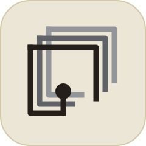
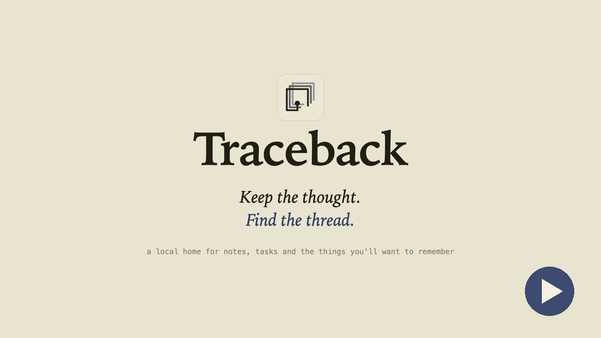
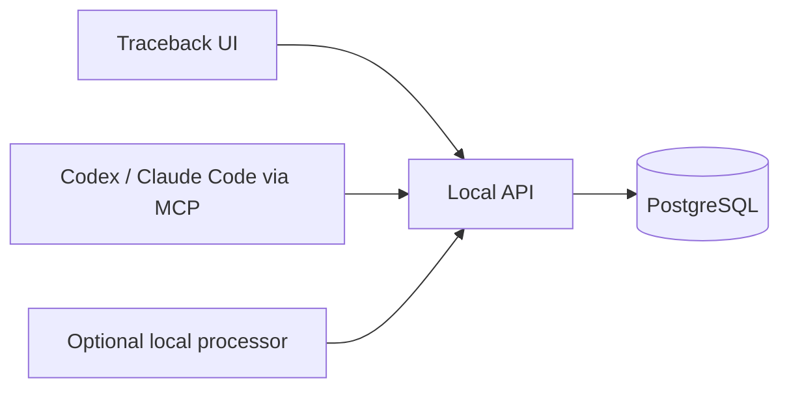

<div align="center">
  

  <h1>Traceback</h1>

  <p><strong>Keep the thought. Find the thread.</strong></p>
  <p>A local home for notes, tasks, projects, and the things you'll want to remember later.</p>

  <p>
    <a href="#get-started">Get started</a> ·
    <a href="#what-you-can-do">Explore features</a> ·
    <a href="#how-it-works">How it works</a>
  </p>

  <p>
    <a href="https://github.com/Vishruth-Sham/Traceback/releases/tag/v0.1.1"></a>
    
    
  </p>

  <a href="https://cdn.jsdelivr.net/gh/Vishruth-Sham/Traceback@main/assets/traceback-demo.mp4"></a>
  <p><sub><a href="https://cdn.jsdelivr.net/gh/Vishruth-Sham/Traceback@main/assets/traceback-demo.mp4">▶ Watch the 28-second demo</a></sub></p>
</div>

---

## What you can do

| | |
|---|---|
| **Catch ideas quickly** | Save a note or task from the app's quick add flow, then organize it when you're ready. |
| **Keep things together** | Nest folders, connect related items, and move work between categories, projects, and Inbox. |
| **Find your way back** | Search across your items and follow folder paths from a note to where it belongs. |
| **Stay in control** | Review changes, archive and restore items, and keep the original text of each capture. |
| **Work with your tools** | Use the local MCP adapter from Codex or Claude Code through the same API as the app. |

Traceback runs on your Mac. The app, API, PostgreSQL database, and optional processing tools stay local; there is no hosted account or cloud fallback.

## Get started

**Requirements:** macOS, Python 3.12–3.14, [uv](https://docs.astral.sh/uv/), Node.js, and PostgreSQL 17 (`brew install postgresql@17`).

1. Install dependencies and create the local database:

   ```sh
   uv sync --extra test --locked
   npm --prefix frontend ci
   python3 scripts/local_db.py init
   ```

   Database credentials and the API token are generated in the ignored root `.env` file. Existing local data is preserved.

2. Create the ignored `frontend/.env.local` file with the API token from `.env`:

   ```dotenv
   TRACEBACK_API_BASE_URL=http://127.0.0.1:8000
   TRACEBACK_API_TOKEN=<copy TRACEBACK_API_TOKEN from the root .env>
   ```

3. Stop the setup database, build the launcher, and open the app:

   ```sh
   python3 scripts/local_db.py stop
   bash scripts/build_mac_launcher.sh
   open Traceback.app
   ```

The launcher starts the local services and opens `http://localhost:3000` in Google Chrome. Quit the app to stop services it started. On later visits, just open `Traceback.app`.

<details>
<summary>Run services without the Mac launcher</summary>

```sh
python3 scripts/local_db.py start
.venv/bin/alembic upgrade head
.venv/bin/uvicorn backend.main:app --host 127.0.0.1 --port 8000
```

In another terminal:

```sh
npm --prefix frontend run dev
```

Open `http://localhost:3000`. The same `frontend/.env.local` file is required.

</details>

## How it works



The Next.js interface talks to a local FastAPI service through a same-origin proxy, so the API token stays out of browser JavaScript. The MCP adapter uses that same API rather than connecting to the database directly. Optional local models can help process captures; manual notes and tasks work without them.

| Directory | Purpose |
|---|---|
| `frontend/` | App interface and local API proxy |
| `backend/` | REST API and data rules |
| `traceback_mcp/` | Local MCP adapter |
| `processor/` | Optional local capture processing |
| `scripts/` | Database, launcher, and model setup |

<details>
<summary>Optional MCP and local models</summary>

With the app running, start the stdio MCP adapter with:

```sh
.venv/bin/python -m traceback_mcp
```

To let Claude Code insert a local image into a note (`insert_note_image`), name the directories it may read from in the adapter's environment, for example `TRACEBACK_MCP_IMAGE_IMPORT_DIRS=~/Pictures/traceback`. Several directories are separated by `:` on macOS and Linux. Without this setting the tool refuses.

To check local model dependencies before downloading anything:

```sh
python3 scripts/model_setup.py
```

Run `python3 scripts/model_setup.py --install` only if you want the missing models installed. The script reports download sizes first.

</details>

---

<div align="center">
  <sub>Your data and credentials live in ignored local files. See <code>.env.example</code> for configuration options.</sub>
</div>
